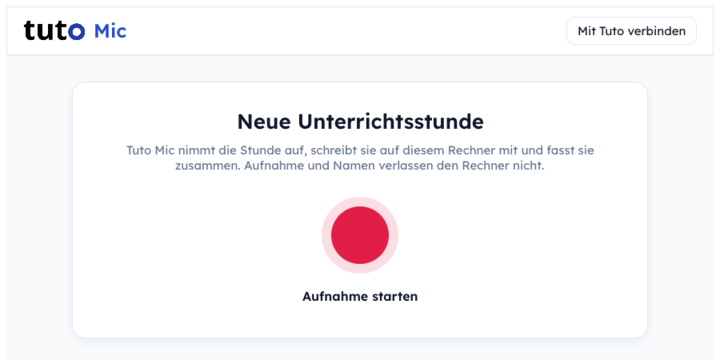
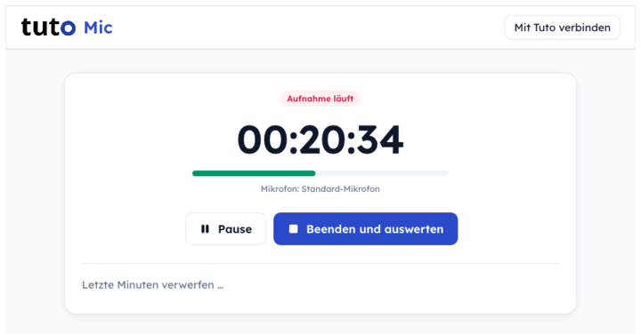
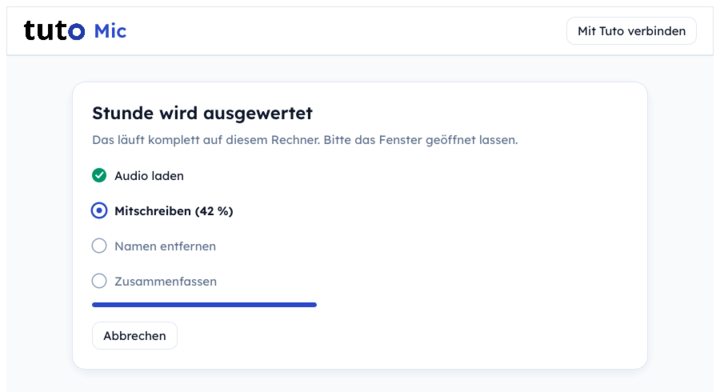
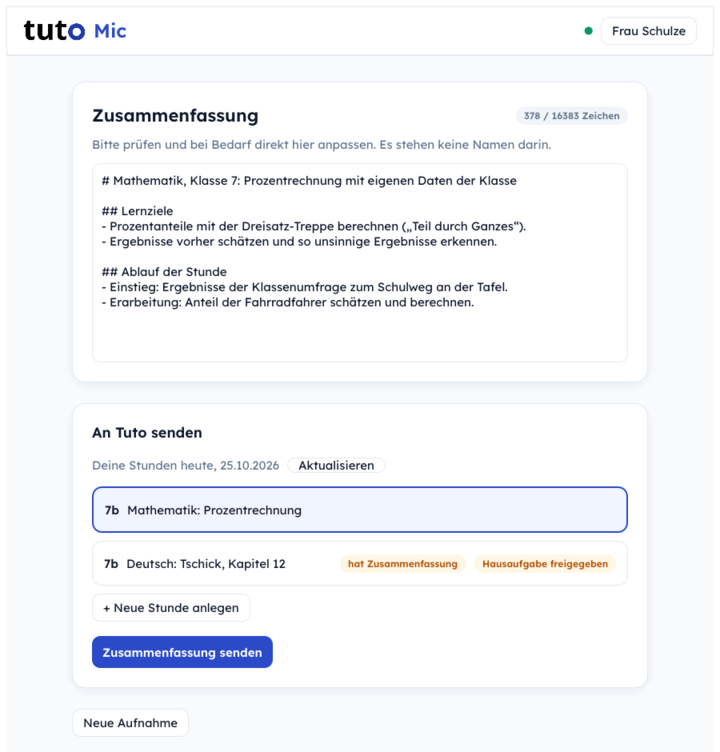
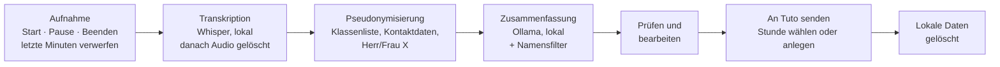

# Tuto Mic

Tuto Mic läuft auf dem PC im Klassenraum und wird von der Lehrkraft bedient: Sie startet die Aufnahme zu
Beginn der Stunde und beendet sie am Ende. Danach schreibt die App die Stunde **auf diesem Rechner** mit
(Whisper), ersetzt Namen von Schüler:innen und Lehrkräften durch Platzhalter und fasst die Stunde mit einem
**lokalen** Sprachmodell (Ollama) zusammen. Die Lehrkraft prüft die Zusammenfassung, korrigiert sie bei Bedarf
und sendet sie an die Lernplattform **Tuto**. Dort entstehen daraus Hausaufgaben: Übungen zum Fach und Fragen,
die nur beantworten kann, wer im Unterricht aufgepasst hat. Aufnahme und Namen verlassen den Rechner nicht.

| Bereit | Aufnahme läuft | Auswertung |
|---|---|---|
|  |  |  |

<p align="center">
  
</p>

*Bilder aus `cargo test ui_preview -- --ignored` mit Beispieldaten.*

## Inhalt

- [So funktioniert's](#so-funktionierts)
- [Datenschutz-Konzept](#datenschutz-konzept)
- [Installation](#installation)
- [Für Schul-IT und Betreuung](#für-schul-it-und-betreuung)
- [Tuto-Anbindung](#tuto-anbindung)
- [Entwicklung](#entwicklung)

## So funktioniert's



1. **Aufnehmen.** Ein großer Knopf startet die Aufnahme; Pause und „Beenden und auswerten“ während der Stunde.
   „Letzte Minuten verwerfen“ löscht rückwirkend 1, 2, 5, 10, 15 oder 30 Minuten, z. B. nach einem privaten Gespräch. Das Audio
   wird in 10-Sekunden-Stücken (16 kHz) gespeichert.
2. **Mitschreiben.** whisper.cpp (Modell large-v3-turbo, mit Silero-VAD gegen erfundenen Text in Sprechpausen)
   transkribiert auf der GPU, ohne Internet. Danach wird das Audio gelöscht.
3. **Namen entfernen.** Deterministischer Code ersetzt Namen und Kontaktdaten durch Platzhalter wie
   `[Schüler A]`, `[Lehrkraft]`, `[E-Mail]` (Details unten).
4. **Zusammenfassen.** Ein lokales Modell über Ollama (Standard `qwen3.5:9b`) erstellt mit dem Prompt aus
   `prompts/summary.md` die Zusammenfassung. Auch deren Text läuft noch einmal durch den Namensfilter.
5. **Prüfen und senden.** Die Lehrkraft sieht und bearbeitet den Text, wählt eine ihrer heutigen Tuto-Stunden
   oder legt eine an (Fach und Thema werden aus der Überschrift vorgeschlagen) und sendet. Hat die Stunde schon
   eine Zusammenfassung, fragt die App vor dem Überschreiben nach.
6. **Aufräumen.** Nach dem erfolgreichen Senden löscht die App die lokalen Daten dieser Stunde.

Ist Ollama nicht erreichbar, entstehen Transkript und pseudonymisiertes Transkript trotzdem; nur die
Zusammenfassung fehlt.

## Datenschutz-Konzept

### Was die App technisch tut

| Maßnahme | Umsetzung |
|---|---|
| Verarbeitung auf dem Rechner | Spracherkennung (whisper.cpp) und Zusammenfassung (Ollama, Standard `http://localhost:11434`) laufen lokal. Internet braucht es nur für den einmaligen Modell-Download und für Tuto. |
| Audio nur so lange wie nötig | Nach der Transkription wird der Audio-Ordner gelöscht (`pipeline.rs`). Bei abgebrochener Auswertung bleibt er erhalten, damit die Stunde nicht verloren ist. Keine Stimmprofile, keine Sprechererkennung. |
| Pseudonymisierung vor jedem KI-Schritt | Regeln in Code statt Anweisung an das Modell (`anonymize.rs`) – lokale Modelle gaben im Test Namen trotz Verbot im Prompt aus. |
| – Klassenliste | Voller Name, Vor- und Nachname einzeln (auch mit Genitiv-s), jede Person ein festes Kürzel (`[Schüler A]`). Teilen sich zwei Personen einen Namensteil, wird er zu `[Schüler]` statt falsch zugeordnet. |
| – Unscharfer Abgleich | Von Whisper falsch geschriebene Namen („Müler“ statt „Müller“) werden über Kölner Phonetik **und** Jaro-Winkler-Ähnlichkeit ≥ 0,9 erkannt; nur großgeschriebene Wörter ab 4 Buchstaben, damit gewöhnliche Wörter stehen bleiben. Die Namen der Klassenliste gehen außerdem als Hinweis an Whisper, damit sie öfter richtig geschrieben werden. |
| – Lehrkräfte, Kontaktdaten | „Herr/Frau (Dr./Prof.) (von) Name“ → `[Lehrkraft]`, E-Mail-Adressen → `[E-Mail]`, Telefonnummern → `[Telefon]`. |
| Ausgabe des Modells gefiltert | Die fertige Zusammenfassung läuft noch einmal durch dieselbe Pseudonymisierung. |
| Keine Klarnamen auf der Platte | Das Original-Transkript wird im normalen Betrieb nicht gespeichert, nur `transcript.anon.txt`, `summary.md`, `export.json` (pseudonymisiert) und `log.txt`. Nur im Admin-Modus bleibt `transcript.txt` zum Prüfen liegen. Ein Test (`pipeline::tests`) stellt sicher, dass keine Namen in die Ausgaben gelangen. |
| Löschen nach dem Senden | Nach erfolgreichem Upload löscht die App den Ordner der Stunde (abschaltbar: `TUTO_MIC_KEEP_SESSIONS`). |
| Anmeldung bei Tuto | OAuth 2.0 mit PKCE im System-Browser: Die App sieht kein Passwort. Das Token liegt im Schlüsselbund des Betriebssystems (Windows-Anmeldeinformationsverwaltung, macOS-Schlüsselbund, Linux Secret Service), nie in Dateien oder Logs. Beim Trennen der Verbindung wird es auch bei Tuto ungültig gemacht. |
| Keine Einstellungen für Lehrkräfte | Lehrkräfte sehen nur den Ablauf. Konfiguration und Klassenliste setzt die Betreuung zentral ([siehe unten](#für-schul-it-und-betreuung)). |

### Grenzen – ehrlich benannt

- **Pseudonymisiert heißt nicht anonym.** Nach DSGVO sind pseudonymisierte Daten weiterhin personenbezogen.
  Inhalte („der mit dem gebrochenen Arm“) können Personen erkennbar machen. Ein echter Schuleinsatz braucht
  eine Rechtsgrundlage bzw. Einwilligungen für die Aufnahme, eine Datenschutz-Folgenabschätzung und für Tuto
  einen Auftragsverarbeitungsvertrag.
- **Ohne Klassenliste keine Schülernamen-Ersetzung.** Die Liste kommt aus der lokalen Konfiguration (`config.json`,
  Umgebungsvariable oder Admin-Modus) und – sobald Tuto `GET /api/v1/roster` anbietet – zusätzlich aus Tuto
  (Klassen der Lehrkraft inkl. Vertretung, nur im Arbeitsspeicher; die App ist dafür vorbereitet). Fehlt sie, warnt das Log. Namen, die nicht
  auf der Liste stehen (z. B. Geschwister, andere Klassen), werden nicht erkannt.
- **Lokale Daten sind unverschlüsselt.** Audio-Stücke (während der Aufnahme) sowie pseudonymisiertes Transkript
  und Zusammenfassung (bis zum Senden) liegen im Klartext im Benutzerprofil. Eine Verschlüsselung ist in Arbeit;
  bis dahin Festplattenverschlüsselung verwenden. Stunden, die nie gesendet werden, bleiben liegen.
- **Was die Lehrkraft eintippt, wird gesendet.** Die Zusammenfassung ist vor dem Senden frei bearbeitbar.
- **Ollama-Adresse ist konfigurierbar.** Zeigt `ollama_url` auf einen anderen Rechner, verlässt das
  pseudonymisierte Transkript den PC.

## Installation

### Pakete

Fertige Programme gibt es unter [Releases](https://github.com/SloppifAI/Tuto_Mic/releases):

| System | Datei | GPU |
|---|---|---|
| Windows 10/11 (x86_64) | `tuto-mic-windows-x86_64.zip` | Vulkan (NVIDIA, AMD, Intel) |
| macOS (Apple Silicon) | `tuto-mic-macos-arm64.tar.gz` | Metal |
| Linux (x86_64, glibc ab Ubuntu 22.04) | `tuto-mic-linux-x86_64.tar.gz` | Vulkan |

Das Archiv enthält das Programm `tuto-mic` (bzw. `tuto-mic.exe`) und diese README; es gibt noch keinen
Installer. Entpacken und starten.

### Voraussetzungen

- **[Ollama](https://ollama.com)** läuft auf demselben Rechner und hat das Modell geladen:
  `ollama pull qwen3.5:9b` (ein anderes Modell über `TUTO_MIC_OLLAMA_MODEL`).
- **GPU** wird automatisch genutzt (Vulkan unter Windows/Linux, Metal unter macOS). Ohne passende GPU rechnet
  Whisper auf der CPU – das funktioniert, ist für eine 45-Minuten-Stunde aber sehr langsam. Unter Linux muss
  `libvulkan.so.1` vorhanden sein (Paket `libvulkan1`), unter Windows bringt sie der Grafiktreiber mit.
- **Erster Start:** Die App lädt einmalig das Spracherkennungsmodell (ca. 550 MB, Knopf
  „Spracherkennung herunterladen“). Danach läuft die Transkription ohne Internet.

### Warnung bei unsignierten Programmen

Die Pakete sind noch nicht signiert (kein Windows-Code-Signing, keine macOS-Notarisierung). Das System warnt
deshalb beim ersten Start:

- **Windows (SmartScreen):** „Der Computer wurde durch Windows geschützt“ → **Weitere Informationen** →
  **Trotzdem ausführen**.
- **macOS (Gatekeeper):** Im Finder Rechtsklick auf `tuto-mic` → **Öffnen** → **Öffnen**. Neuere macOS-Versionen
  bieten das nicht mehr an; dann nach dem ersten Versuch unter *Systemeinstellungen → Datenschutz & Sicherheit*
  **Dennoch öffnen** wählen. Alternativ im Terminal das Quarantäne-Attribut entfernen:
  `xattr -d com.apple.quarantine tuto-mic`.

### Download prüfen

Jedes Release enthält `SHA256SUMS.txt` und einen signierten Herkunftsnachweis (GitHub Build-Provenance), der
belegt, dass das Paket von der Release-Pipeline dieses Repositorys gebaut wurde:

```sh
sha256sum -c SHA256SUMS.txt --ignore-missing          # Prüfsumme (macOS: shasum -a 256 -c …)
gh attestation verify tuto-mic-linux-x86_64.tar.gz --repo SloppifAI/Tuto_Mic
```

## Für Schul-IT und Betreuung

### Konfiguration

Lehrkräfte sehen keine Einstellungen. Es gelten Standardwerte; die Betreuung ändert sie zentral, in dieser
Reihenfolge (spätere gewinnen):

1. eingebaute Standardwerte
2. Datei `config.json` – Pfad mit `tuto-mic paths`, oder für alle Benutzer festgelegt über
   `TUTO_MIC_CONFIG=/pfad/config.json`
3. Umgebungsvariablen `TUTO_MIC_*`

Eine fehlerhafte Datei oder Variable wird nicht still ignoriert, sondern gemeldet (sonst ginge unbemerkt die
Klassenliste verloren).

| Variable | Feld in `config.json` | Bedeutung | Standard |
|---|---|---|---|
| `TUTO_MIC_TUTO_URL` | `tuto_url` | Adresse der Tuto-Instanz | `https://hackathon.sebastian-bleuel.de` |
| `TUTO_MIC_SUMMARY_LIMIT` | `summary_limit` | Höchstlänge der Zusammenfassung in Zeichen | `16383` |
| `TUTO_MIC_OLLAMA_URL` | `ollama_url` | Adresse von Ollama | `http://localhost:11434` |
| `TUTO_MIC_OLLAMA_MODEL` | `ollama_model` | Sprachmodell für die Zusammenfassung | `qwen3.5:9b` |
| `TUTO_MIC_LANGUAGE` | `language` | Sprache für Whisper | `de` |
| `TUTO_MIC_WHISPER_MODEL` | `whisper_model` | Pfad zum Whisper-Modell | im Datenverzeichnis |
| `TUTO_MIC_VAD_MODEL` | `vad_model` | Pfad zum VAD-Modell | im Datenverzeichnis |
| `TUTO_MIC_DELETE_AUDIO` | `delete_audio_after_transcription` | Audio nach der Transkription löschen | `true` |
| `TUTO_MIC_KEEP_SESSIONS` | `keep_sessions_after_upload` | Daten nach dem Senden an Tuto behalten | `false` |
| `TUTO_MIC_CLASS_LIST` | `class_list` | Klassenliste; Variable: Namen mit `;` getrennt, Datei: Liste | leer |

Nur in der Datei: `num_ctx` (Kontextlänge für Ollama, `32768`) und `segment_secs` (Länge der Audio-Stücke,
`10`; bestimmt die Genauigkeit von „letzte Minuten verwerfen“). Beispiel:

```json
{
  "tuto_url": "https://tuto.schule.example",
  "ollama_model": "qwen3.5:9b",
  "class_list": ["Lena Wagner", "Tom Becker"]
}
```

### Befehle

```sh
tuto-mic info            # Version, Whisper-Backend (GPU oder CPU), Modelle, gültige Konfiguration, gesetzte Variablen
tuto-mic paths           # Pfade von Konfiguration, Prompts, Sitzungen, Modellen
tuto-mic download        # Modelle vorab laden (~550 MB), z. B. bei der Einrichtung
tuto-mic --admin         # GUI mit Admin-Menü (auch TUTO_MIC_ADMIN=1)
```

Der **Admin-Modus** ergänzt die Oberfläche um Einstellungen (inkl. Klassenliste, schreibt `config.json`),
einen Prompt-Editor, die Ansicht „Transkript und Log“ (pseudonymisiert und Original) und den Import von Audio-
oder Textdateien. Für den Unterricht die App ohne `--admin` starten.

Jede Auswertung schreibt nach `<Daten>/sessions/<Zeitstempel>/` eine `log.txt` mit Dauer, verwendetem Gerät
(z. B. `Whisper: Vulkan (GPU: Vulkan0)`) und Warnungen.

### Empfehlungen für den Klassenraum-PC

- Eigenes Benutzerkonto für den Unterricht, **ohne Administratorrechte**; Konfiguration per
  `TUTO_MIC_CONFIG` an einem Ort, den dieses Konto nicht schreiben kann.
- **Festplattenverschlüsselung** (BitLocker, FileVault, LUKS), solange die App lokale Daten nicht selbst
  verschlüsselt.
- Ollama nur lokal lauschen lassen (Standard `127.0.0.1:11434`).
- Eine GPU mit aktuellem Treiber; `tuto-mic info` zeigt, ob Whisper sie findet. Auf Laptops mit zwei GPUs
  nimmt Tuto Mic die dedizierte.

## Tuto-Anbindung

„Mit Tuto verbinden“ (Kopfzeile oder Ergebnisseite) öffnet die Tuto-Anmeldung im Browser. Nach **Erlauben**
springt der Browser über `tutoapp://callback` zurück in die App; unter Windows und Linux registriert sich die
App dafür selbst. Unter macOS (und falls der Rücksprung nicht klappt) die Adresse aus der Adresszeile des
Browsers in die App einfügen. Danach zeigt die App die heutigen Stunden der Lehrkraft, kann eine neue anlegen
und sendet die Zusammenfassung.

Dasselbe ohne GUI, zum Testen und für Skripte:

```sh
tuto-mic tuto login                              # Anmeldung im Browser
tuto-mic tuto status                             # Verbindung anzeigen
tuto-mic tuto lessons [--date 2026-10-23]        # Stunden eines Tages
tuto-mic tuto send <sitzungsordner|summary.md> --lesson <id>
tuto-mic tuto logout                             # Token bei Tuto ungültig machen und lokal löschen
```

`tuto send` über die CLI löscht den Sitzungsordner nicht.

## Entwicklung

Regeln für Beiträge (auch für KI-Agenten), Datenschutzregeln für Tests und Hinweise gegen lange Build-Zeiten:
**[`AGENTS.md`](AGENTS.md)**.

### Umgebung

Mit Nix (empfohlen): Die Devshell enthält Rust, rust-analyzer, cmake, clang, GUI-/Audio-/Vulkan-Bibliotheken
und die Prüfwerkzeuge. Mit direnv lädt `.envrc` sie automatisch (`direnv allow`).

```sh
nix develop                  # Standard: Whisper per Vulkan
nix develop .#cuda           # zusätzlich CUDA (NVIDIA), dann: cargo app --features cuda
cargo app --admin            # App als Release-Build starten (Alias aus .cargo/config.toml)
cargo app info               # zeigt, ob Whisper die GPU findet
cargo app process stunde.mp3 [--no-llm]   # ohne GUI, z. B. zum Prompt-Testen
cargo app process stunde.txt              # fertiges Transkript (.txt/.md): ohne Whisper
```

Ohne Nix: Rust (stable), cmake, clang/libclang; unter Linux zusätzlich
`libasound2-dev libxkbcommon-dev libwayland-dev libvulkan-dev glslc` (Ubuntu ab 24.04), unter Windows das
[Vulkan-SDK](https://vulkan.lunarg.com/sdk/home) mit gesetztem `VULKAN_SDK`.

**Stand von `main` starten:** `scripts/start.sh [--admin]` baut und startet den letzten Commit auf `main` in
einem eigenen Worktree (`../Tuto_Mic-start`), unabhängig von halbfertigen Änderungen.
`scripts/install-launcher.sh` legt dafür die Menüeinträge „Tuto Mic“ und „Tuto Mic (Admin)“ an (Linux).

### Prüfungen

```sh
cargo test                                  # Unit-Tests, ohne Modelle, Mikrofon oder Ollama
cargo clippy --all-targets -- -D warnings   # Lints inkl. clippy::pedantic
cargo fmt --check
cargo deny check                            # Sicherheitslücken, Lizenzen (deny.toml)
cargo machete                               # ungenutzte Abhängigkeiten
cargo test ui_preview -- --ignored          # alle GUI-Zustände als PNG nach target/ui-preview/
```

### Prompt

`prompts/summary.md` ist eingebaut. Überschreiben lässt er sich im Admin-Modus (Seite **Prompt**, speichert
nach `<config>/prompts/`) oder per `TUTO_MIC_PROMPTS=./meine-prompts` (Datei `summary.md`). Das Transkript
ersetzt `{{TRANSKRIPT}}`; fehlt der Platzhalter, wird es angehängt.

### GPU

Whisper nutzt die GPU ohne Feature-Flag: Vulkan unter Linux/Windows, Metal unter macOS; optional
`--features cuda`. Messung (RTX 3080 Laptop, large-v3-turbo): 33 min Unterricht mit Vulkan in 64 s, mit CUDA
in etwa 66 s; 2,5 min Audio auf der CPU nach 16 min erst zu 31 % fertig.

### CI und Release

- [`ci.yml`](.github/workflows/ci.yml): bei Push und Pull Request `fmt`, `clippy`, `test`, `deny`, `machete`
  (Linux).
- [`release.yml`](.github/workflows/release.yml): Builds für Linux, Windows, macOS (arm64). Ein Tag `v*`
  erzeugt ein GitHub-Release mit Paketen, `SHA256SUMS.txt` und Herkunftsnachweis; „Run workflow“ baut nur
  Test-Artefakte.

```sh
git tag v0.1.0 && git push origin v0.1.0
```

Offen: Signierung (Windows-Code-Signing, macOS-Notarisierung), Installer, `.app`-Paket für macOS.

### Aufbau

| Modul | Aufgabe |
|---|---|
| `src/main.rs`, `src/lib.rs` | Einstieg (CLI/GUI) bzw. Bibliothek mit der gesamten Logik |
| `src/app/` | egui-Oberfläche: Ablauf für Lehrkräfte (`screens.rs`), Admin-Seiten (`admin.rs`), Bildschirmfotos (`snapshots.rs`) |
| `src/tuto_panel.rs` | GUI der Tuto-Anbindung: Kontostatus, Stunde wählen/anlegen, senden |
| `src/tuto/` | Tuto-Anbindung: Anmeldung (PKCE), Schnittstelle, Token im Schlüsselbund, CLI |
| `src/deeplink.rs` | `tutoapp://`-Links registrieren und an die laufende App weitergeben |
| `src/control.rs` | Befehle (Start/Pause/Stop/Löschen) und Aufnahmezustand – Schnittstelle für einen späteren Hardware-Taster |
| `src/recorder.rs` | Mikrofon (cpal), Resampling, Segment-Dateien, rückwirkendes Löschen |
| `src/audio.rs` | Audio laden/dekodieren (symphonia), Resampling auf 16 kHz (rubato) |
| `src/transcribe.rs` | whisper.cpp über whisper-rs, Klassenliste als Hinweis |
| `src/gpu.rs` | Whisper-Backend (Vulkan/Metal/CUDA) und Wahl der GPU |
| `src/models.rs` | Download der Whisper- und VAD-Modelle |
| `src/anonymize.rs` | Pseudonymisierung |
| `src/llm.rs` | Ollama-HTTP-API |
| `src/pipeline.rs` | Ablauf nach der Aufnahme, Export |
| `src/session.rs` | Ein Ordner pro Aufnahme, sicheres Löschen |
| `src/config.rs` | Einstellungen, `TUTO_MIC_*`-Variablen |
| `src/prompts.rs`, `prompts/` | eingebauter + überschreibbarer Prompt |
| `src/theme.rs`, `src/icons.rs`, `assets/` | Tuto-Design, Schrift Lexend, selbst gezeichnete Icons |
